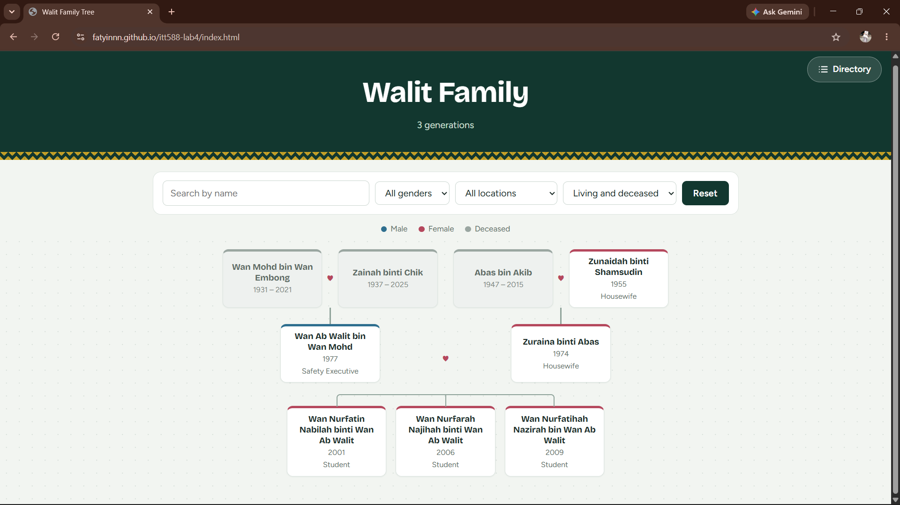
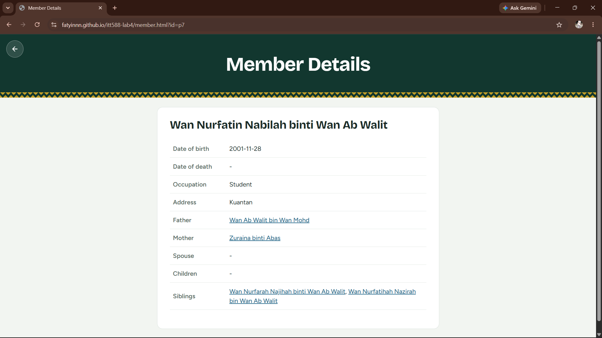
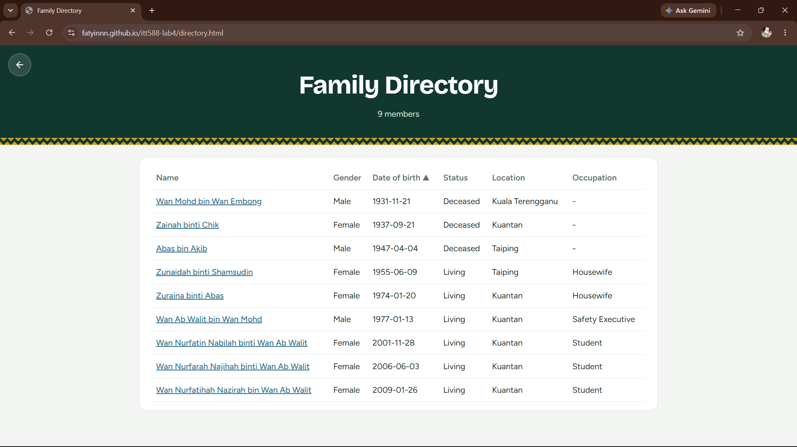
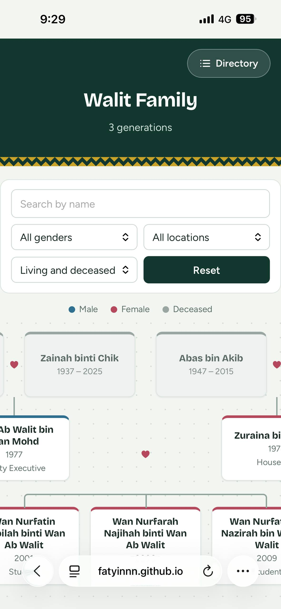
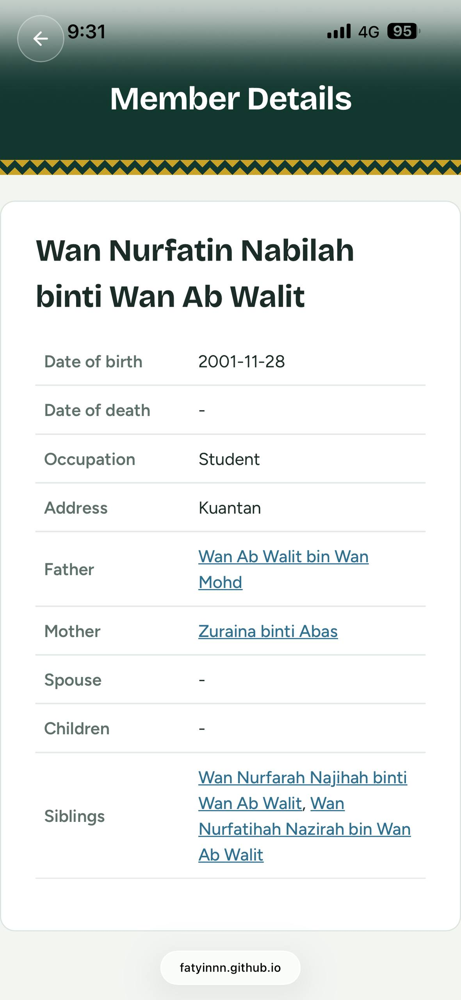
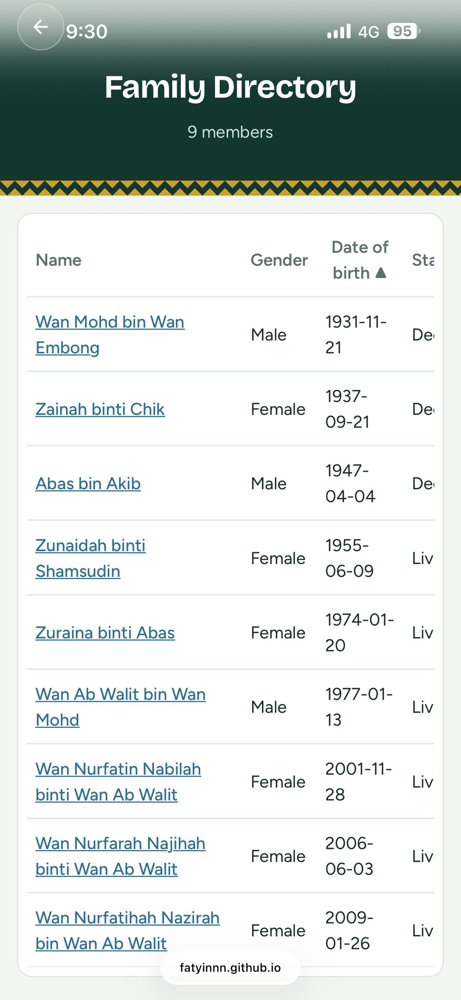

# Walit Family Tree

ITT588 Lab Work 4: a front-end web app that visualises a family heritage dataset stored in JSON.

**Live demo:** https://fatyinnn.github.io/itt588-lab4/

## Objectives
- Retrieve and process family heritage data from a JSON dataset using JavaScript
- Display family members and relationships (parents, spouses, children) dynamically
- Provide filtering and navigation to explore the family information

## Features
- **Family tree**: parents, spouses and children drawn from the JSON data
- **Search and filters**: by name, gender, location and living/deceased status
- **Member details page**: full information with clickable links to father, mother, spouse, children and siblings
- **Directory page**: sortable table of all family members
- Deceased members are shown in grey with their years of birth and death

## Screenshots

## Mobile view
| Home | Member details | Directory |
|---|---|---|
| |  |  |  | |

## Project structure (MVC)
| Layer | File | Role |
|---|---|---|
| Model | `js/model.js` | Loads the JSON and answers relationship queries (parents, spouses, children, siblings, filtering) |
| View | `js/view.js` | Renders the tree, cards, detail page and directory table as HTML |
| Controller | `js/controller.js` | Handles events (search, filters, sorting) and connects Model and View |
| Entry point | `js/main.js` | Chooses which page to start |

Dataset: `data/people.json`. Styling: `css/style.css`.

## How it works
Each person has an `id`, and relationships are stored as ids (`fatherId`, `motherId`, `spouses`). Children are found by searching for people whose `fatherId` or `motherId` matches.

## How to run locally
Because the app uses `fetch()`, it must run on a local server (not by double-clicking the file):
1. Open the folder in VS Code
2. Install the **Live Server** extension
3. Right-click `index.html` → **Open with Live Server**

## Technologies
HTML, CSS, JavaScript (ES modules, no framework), JSON, GitHub Pages

## Author
WAN NURFATIN NABILAH BINTI WAN AB WALIT – 2024771563 – CS266 6C – ITT588